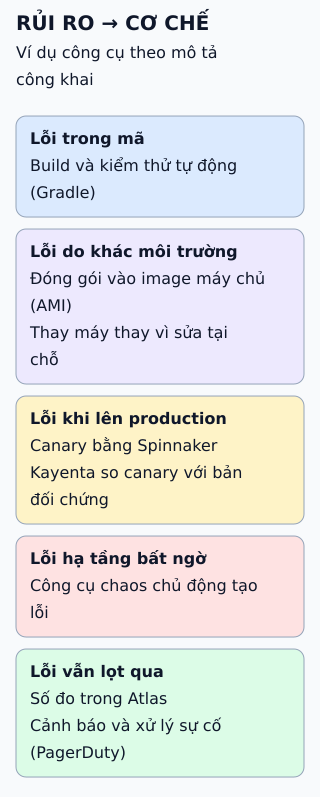

# Chuỗi CI/CD của Netflix qua từng giai đoạn

Một đội lớn nối công cụ riêng cho từng giai đoạn. Bài này đọc chuỗi đó như ví dụ về cách chia giai đoạn, không phải công thức nên chép.

**Đọc hình:** tên công cụ lấy từ mô tả trong nguồn; đây là ảnh chụp tại một thời điểm, có thể đã đổi.

## Nhìn hình thử trả lời

Kayenta trong chuỗi này làm gì, và vì sao đi cùng triển khai canary?

Xem đáp án

Kayenta là công cụ phân tích canary tự động: so sánh số đo của bản canary với bản đối chứng để quyết định tiếp tục hay dừng. Canary chỉ có ích khi có nhận định khách quan từ số đo.

## Giới hạn cần nhớ

Công cụ của một công ty lớn gắn với nhu cầu riêng (AMI, quy mô lớn). Nhóm nhỏ không cần chép công cụ, mà nên chép ý tưởng: tách giai đoạn, tự động hóa, triển khai từng phần và đo.

Xem sâu hơn

- **AMI:** image máy ảo của AWS; đóng gói cả ứng dụng vào image rồi thay máy chủ thay vì cập nhật tại chỗ.
- **Spinnaker:** nền tảng triển khai nhiều đám mây do Netflix tạo ra, mã nguồn mở, hỗ trợ chiến lược như canary.
- **Atlas:** hệ thống số đo chuỗi thời gian của Netflix.
- **Chaos:** công cụ như Chaos Monkey chủ động tạo lỗi để kiểm chứng hệ thống chịu lỗi.
- **Tính thời điểm:** mô tả công khai có thể đã cũ; không dùng để suy ra hiện trạng.

## Nguồn đối chiếu

- [ByteByteGo tại snapshot cố định](https://github.com/ByteByteGoHq/system-design-101/blob/b28380a4710c5ec9638ec037d4168e288f334cba/data/guides/netflix-tech-stack-cicd-pipeline.md).
- [Spinnaker](https://spinnaker.io/) và [Kayenta](https://github.com/spinnaker/kayenta).
- Netflix: [Atlas](https://github.com/Netflix/atlas), [Chaos Monkey](https://netflix.github.io/chaosmonkey/).
