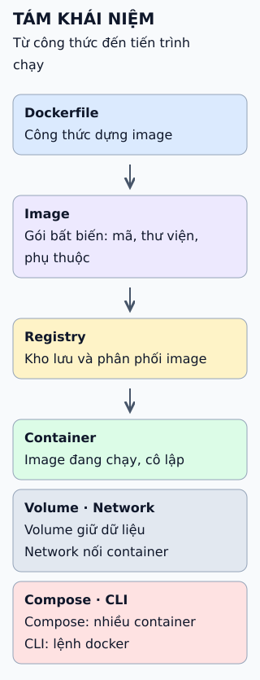

# Tám khái niệm Docker cần biết

Hãy theo một câu chuyện: đưa ứng dụng từ laptop lên máy chủ. Mỗi chặng của câu chuyện cần một khái niệm Docker khác nhau.

**Đọc hình:** tám khái niệm gồm Dockerfile, image, registry, container, volume, network, Compose và CLI.

## Nhìn hình thử trả lời

Xóa một container có làm mất dữ liệu trong volume đã đặt tên mà nó dùng không?

Xem đáp án

Không. Volume tồn tại độc lập với container, nên dữ liệu vẫn còn cho tới khi bạn xóa volume.

## Giới hạn cần nhớ

Container không phải máy ảo: nhiều container dùng chung nhân của máy chủ. Cô lập của container phụ thuộc cấu hình nên không coi là hàng rào bảo mật tuyệt đối.

Xem sâu hơn

- **Image gồm nhiều lớp** chỉ đọc; container thêm một lớp ghi ở trên cùng.
- **Compose** mô tả dịch vụ, mạng và volume trong một tệp, hợp cho môi trường phát triển hoặc triển khai nhỏ.
- **Network:** container trên cùng một network do người dùng tạo gọi nhau bằng tên dịch vụ.
- **Registry:** Docker Hub là mặc định; có thể dùng registry riêng.

## Nguồn đối chiếu

- [ByteByteGo tại snapshot cố định](https://github.com/ByteByteGoHq/system-design-101/blob/b28380a4710c5ec9638ec037d4168e288f334cba/data/guides/top-8-must-know-docker-concepts.md).
- Docker: [khái niệm cơ bản](https://docs.docker.com/get-started/docker-concepts/the-basics/what-is-a-container/), [Compose](https://docs.docker.com/compose/), [volume](https://docs.docker.com/engine/storage/volumes/).
