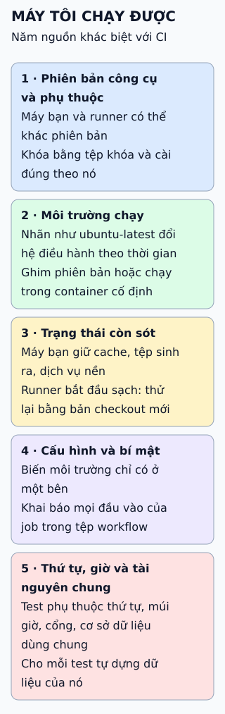

# CI/CD qua một hình đơn giản

Ba câu hỏi đơn giản cho biết nhóm bạn đang ở đâu trên thang tự động hóa, và chữ "CD" đang được hiểu theo nghĩa nào.

**Đọc hình:** ba bậc xếp theo mức tự động tăng dần; nhiều tài liệu dùng "CD" cho cả hai bậc sau.

## Nhìn hình thử trả lời

Sau khi mọi kiểm thử qua, ai bấm nút đưa bản lên production trong Delivery và trong Deployment?

Xem đáp án

Delivery: người hoặc quy trình duyệt quyết định thời điểm. Deployment: hệ thống tự làm, không cần bấm.

## Giới hạn cần nhớ

CI/CD không phải là cài một công cụ. CI chỉ có ý nghĩa khi mọi người gộp mã thường xuyên và kiểm thử đủ tin cậy; không có kiểm thử tốt thì tự động hóa chỉ đưa lỗi lên nhanh hơn.

Xem sâu hơn

- **CI:** lỗi tích hợp lộ sớm khi còn nhỏ vì mỗi lần gộp đều được kiểm tra.
- **Delivery:** việc phát hành là quyết định kinh doanh, không phải vấn đề kỹ thuật.
- **Deployment:** cần giám sát và khả năng quay lui tốt vì không còn người chặn ở cửa cuối.

## Nguồn đối chiếu

- [ByteByteGo tại snapshot cố định](https://github.com/ByteByteGoHq/system-design-101/blob/b28380a4710c5ec9638ec037d4168e288f334cba/data/guides/cicd-simplified-visual-guide.md).
- Martin Fowler: [Continuous Integration](https://martinfowler.com/articles/continuousIntegration.html), [Continuous Delivery](https://martinfowler.com/bliki/ContinuousDelivery.html).
