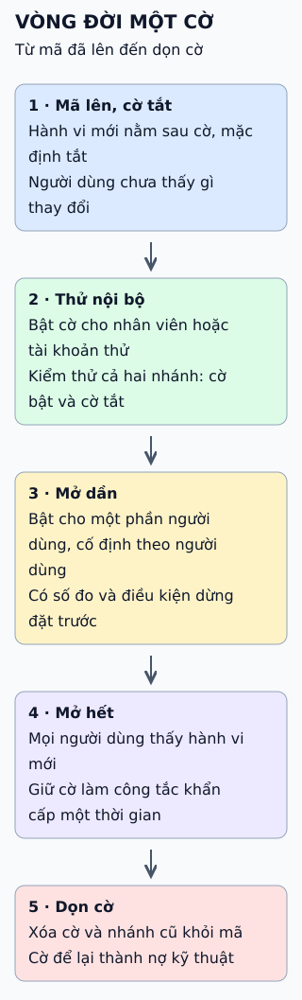

# Chọn cách đưa bản mới lên: triển khai khác phát hành

Hai việc hay bị gộp: triển khai là đưa mã lên môi trường, phát hành là cho người dùng thấy hành vi mới. Tách chúng ra giúp chọn cách đưa lên an toàn.

**Đọc hình:** không có cách nào đúng cho mọi trường hợp; hai nhóm đầu có thể dùng cùng nhau.

## Nhìn hình thử trả lời

Một bản triển khai có cả sửa lỗi không gắn cờ và một tính năng gắn cờ. Tắt cờ có đưa hệ thống về như trước bản triển khai không?

Xem đáp án

Không. Tắt cờ chỉ rút phần được gắn cờ; sửa lỗi, thay đổi cấu hình hay migration không gắn cờ vẫn còn. Muốn về như trước cần rút lại cả triển khai.

## Giới hạn cần nhớ

Rolling, canary và blue-green cho phép hai phiên bản cùng tồn tại, nên dữ liệu và giao tiếp phải tương thích hai chiều. Đổi lược đồ cơ sở dữ liệu thường phải chia nhiều bước.

Xem sâu hơn

- **Blue-green:** tốn thêm một môi trường song song trong lúc chuyển; ưu điểm là quay lại bằng cách chuyển lại traffic.
- **Canary:** cần số đo để quyết định mở rộng hay dừng.
- **Rolling:** ít tốn tài nguyên thêm nhưng lỗi chỉ lộ dần, nên cần giám sát từng đợt.
- **Cờ tính năng:** tách triển khai khỏi phát hành; cờ cũ tích lại thành nợ nếu không dọn.
- **Shadow:** cẩn thận với tác dụng phụ như ghi dữ liệu hay gọi dịch vụ ngoài từ bản được thử.

## Nguồn đối chiếu

- [ByteByteGo tại snapshot cố định](https://github.com/ByteByteGoHq/system-design-101/blob/b28380a4710c5ec9638ec037d4168e288f334cba/data/guides/top-5-most-used-deployment-strategies.md).
- Martin Fowler: [BlueGreenDeployment](https://martinfowler.com/bliki/BlueGreenDeployment.html), [CanaryRelease](https://martinfowler.com/bliki/CanaryRelease.html), [Feature Toggles](https://martinfowler.com/articles/feature-toggles.html).
