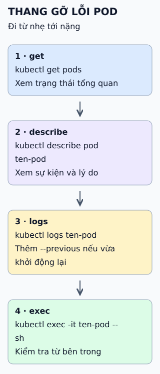

# Bảng tra lệnh kubectl theo tình huống

Nhớ từng lệnh khó hơn nhớ thang gỡ lỗi: xem tổng quan, xem sự kiện, đọc nhật ký, rồi mới chui vào container.



**Đọc hình:** lệnh nặng hơn khi xuống dưới; thường nên dừng ở bước đủ để hiểu lỗi.

## Nhìn hình thử trả lời

Pod ở trạng thái CrashLoopBackOff. Lệnh nào cho xem nhật ký của lần chạy trước vừa chết?

<details>
<summary>Xem đáp án</summary>

`kubectl logs ten-pod --previous`. Kèm `kubectl describe pod ten-pod` để xem lý do thoát và các sự kiện.

</details>

## Giới hạn cần nhớ

Trước khi chạy lệnh thay đổi, kiểm tra đang trỏ vào cụm và namespace nào (`kubectl config current-context` chỉ in tên context). Namespace đang dùng xem bằng `kubectl config view --minify --output "jsonpath={..namespace}"`; kết quả trống nghĩa là namespace `default`. Lệnh `delete` và `apply` đúng lệnh nhưng sai cụm hoặc sai namespace vẫn là sự cố.

<details>
<summary>Xem sâu hơn</summary>

```bash
kubectl config get-contexts          # các cụm đang cấu hình
kubectl config use-context <ten>     # chuyển cụm
kubectl cluster-info                 # kiểm tra kết nối
kubectl get nodes                    # tình trạng node
kubectl apply -f deployment.yaml     # áp dụng cấu hình
kubectl rollout status deployment/web
kubectl rollout undo deployment/web  # quay lui
kubectl scale deployment/web --replicas=3
kubectl port-forward svc/web 8080:80 # thử cục bộ
kubectl get events --sort-by=.lastTimestamp
```

- Ưu tiên khai báo (`apply`) hơn lệnh trực tiếp để cấu hình nằm trong kho mã.
- Thêm `-n <namespace>` hoặc `-A` để nhìn đúng phạm vi.

</details>

## Nguồn đối chiếu

- [ByteByteGo tại snapshot cố định](https://github.com/ByteByteGoHq/system-design-101/blob/b28380a4710c5ec9638ec037d4168e288f334cba/data/guides/the-ultimate-kubernetes-command-cheatsheet.md).
- Kubernetes: [kubectl quick reference](https://kubernetes.io/docs/reference/kubectl/quick-reference/), [debug Pod](https://kubernetes.io/docs/tasks/debug/debug-application/debug-pods/).
