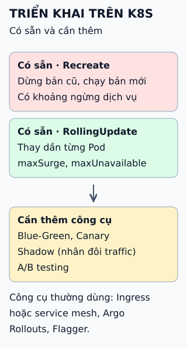

# Chiến lược triển khai trên Kubernetes

Deployment của Kubernetes có sẵn hai chiến lược. Các chiến lược khác cần thêm công cụ hoặc lớp mạng.

**Đọc hình:** "Có sẵn" nghĩa là Kubernetes tự làm khi bạn sửa Deployment; nhóm dưới cần cấu hình định tuyến traffic.

## Nhìn hình thử trả lời

Deployment 3 Pod, `maxSurge: 1`, `maxUnavailable: 0`. Trong lúc cập nhật có tối đa bao nhiêu Pod, và có lúc nào ít hơn 3 Pod sẵn sàng không?

Xem đáp án

Tối đa 4 Pod (3 + 1 tạm thời). Không có lúc nào dưới 3 Pod sẵn sàng vì `maxUnavailable` là 0.

## Giới hạn cần nhớ

"Không ngừng dịch vụ" của RollingUpdate chỉ đúng khi readiness probe chính xác và hai phiên bản tương thích khi chạy song song. Probe sai thì Pod mới nhận traffic quá sớm.

Xem sâu hơn

- **Recreate:** hợp khi hai phiên bản không thể chạy cùng lúc (ví dụ khóa dữ liệu độc quyền).
- **Canary đơn giản:** hai Deployment cùng sau một Service, chỉnh tỉ lệ số Pod; chia traffic theo phần trăm chính xác cần Ingress hoặc mesh.
- **Blue-Green:** hai Deployment hoặc hai môi trường, đổi selector hoặc đường vào.
- **Shadow:** bản sao traffic gửi tới phiên bản mới nhưng phản hồi bị bỏ; cần cẩn thận với tác dụng phụ như ghi dữ liệu.
- **A/B testing** là thí nghiệm sản phẩm theo nhóm người dùng, không phải cách triển khai an toàn.

## Nguồn đối chiếu

- [ByteByteGo tại snapshot cố định](https://github.com/ByteByteGoHq/system-design-101/blob/b28380a4710c5ec9638ec037d4168e288f334cba/data/guides/kubernetes-deployment-strategies.md).
- Kubernetes: [Deployment](https://kubernetes.io/docs/concepts/workloads/controllers/deployment/), [canary](https://kubernetes.io/docs/concepts/workloads/management/#canary-deployments).
- [Argo Rollouts](https://argo-rollouts.readthedocs.io/), [Flagger](https://docs.flagger.app/).
