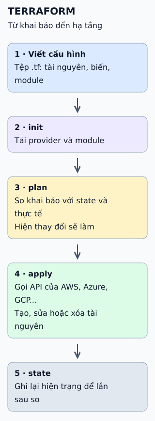

# Terraform biến mã thành hạ tầng

Terraform luôn so ba thứ: hạ tầng bạn muốn, hạ tầng nó nhớ, và hạ tầng đang tồn tại. Các lệnh chỉ là cách đọc và cập nhật ba thứ đó.

**Đọc hình:** lệnh `init` chuẩn bị trước đó, tải provider; hai lệnh ở dưới là hai bước đọc và ghi.

## Nhìn hình thử trả lời

Có người sửa tài nguyên bằng tay trên giao diện cloud. `plan` kế tiếp cho thấy gì?

Xem đáp án

Sự lệch (drift): Terraform đọc hiện trạng thật, thấy khác cấu hình và đề xuất đưa tài nguyên về như trong tệp .tf.

## Giới hạn cần nhớ

State và tệp plan đã lưu đều có thể chứa dữ liệu nhạy cảm dạng rõ, nên không để trong kho mã công khai và không đăng như một artifact build thông thường. Làm nhóm thì dùng backend từ xa có khóa để hai người không apply cùng lúc.

Xem sâu hơn

- **plan lưu được:** `terraform plan -out=tfplan` rồi `terraform apply tfplan` bảo đảm áp dụng đúng bản đã duyệt. Tệp plan chứa cấu hình đầy đủ và có thể cả giá trị nhạy cảm, nên coi như bí mật: giới hạn quyền đọc, giữ thời gian ngắn, xóa sau khi apply và không công khai trong log hay artifact.
- **Mất state:** Terraform không còn biết nó đang quản lý tài nguyên nào, nên cần sao lưu hoặc dùng backend có phiên bản.
- **Trong CI:** `plan` thường chạy tự động để người duyệt đọc; `apply` sau khi có quyết định.

## Nguồn đối chiếu

- [ByteByteGo tại snapshot cố định](https://github.com/ByteByteGoHq/system-design-101/blob/b28380a4710c5ec9638ec037d4168e288f334cba/data/guides/how-does-terraform-turn-code-into-cloud.md).
- HashiCorp: [giới thiệu](https://developer.hashicorp.com/terraform/intro), [lệnh plan](https://developer.hashicorp.com/terraform/cli/commands/plan), [state](https://developer.hashicorp.com/terraform/language/state).
