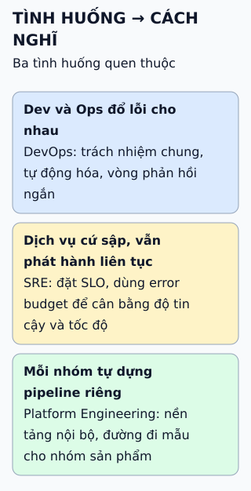

# DevOps, SRE và Platform Engineering khác nhau thế nào

Ba cái tên cùng hướng tới phát hành nhanh và vận hành ổn định, nhưng mỗi cái nhấn vào một câu hỏi khác.

**Đọc hình:** ba thẻ song song, không xếp cấp bậc; một tổ chức có thể làm cả ba.

## Nhìn hình thử trả lời

Nhóm đã dùng hết "error budget" của tháng. Theo tinh thần SRE nên làm gì?

Xem đáp án

Giảm tốc độ phát hành tính năng mới và ưu tiên việc tăng độ tin cậy, cho tới khi lại nằm trong mục tiêu mức dịch vụ (SLO).

## Giới hạn cần nhớ

Tên chức danh không đồng nghĩa giữa các công ty: "DevOps engineer" ở nơi này có thể là việc của SRE hay platform ở nơi khác. Nên hỏi công việc cụ thể thay vì dựa vào tên.

Xem sâu hơn

- **DevOps** là phong trào và tập thực hành; thuật ngữ lan rộng từ cộng đồng quanh các hội thảo DevOpsDays đầu tiên (2009).
- **SRE** bắt nguồn tại Google và được mô tả trong sách SRE: dùng kỹ thuật phần mềm để vận hành, quản lý rủi ro bằng SLO và error budget.
- **Platform Engineering** xây nền tảng nội bộ (internal developer platform) với đường đi mẫu để giảm tải nhận thức cho nhóm sản phẩm.
- **Bài không khẳng định** quan hệ "cái này xây trên cái kia" như một số mô tả; ba khái niệm phát triển song song và chồng lấn.

## Nguồn đối chiếu

- [ByteByteGo tại snapshot cố định](https://github.com/ByteByteGoHq/system-design-101/blob/b28380a4710c5ec9638ec037d4168e288f334cba/data/guides/devops-vs-sre-vs-paltform-engg.md).
- Google: [sách SRE, chương về mục tiêu mức dịch vụ](https://sre.google/sre-book/service-level-objectives/), [error budget](https://sre.google/workbook/error-budget-policy/).
- Platform Engineering: [định nghĩa](https://platformengineering.org/blog/what-is-platform-engineering).
