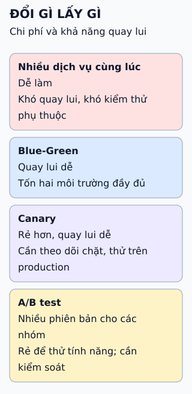

# Giảm rủi ro khi triển khai: bốn cách, bốn mức chi phí

Triển khai luôn có rủi ro. Mỗi cách đổi một thứ lấy một thứ: chi phí hạ tầng, độ phức tạp, hay mức dễ quay lui.

**Đọc hình:** mỗi thẻ là một đánh đổi; không có cách tốt nhất cho mọi trường hợp.

## Nhìn hình thử trả lời

Cách nào cần chạy song song hai môi trường đầy đủ, và vì sao điều đó là chi phí?

Xem đáp án

Blue-Green. Môi trường mới phải có quy mô như môi trường đang chạy trong lúc chuyển, nên tốn gần gấp đôi tài nguyên trong khoảng đó.

## Giới hạn cần nhớ

Với nhiều dịch vụ, rủi ro lớn nhất là hợp đồng giữa các dịch vụ. Dịch vụ mới phải chịu được đầu vào của dịch vụ cũ và ngược lại, nếu không thì dù dùng canary hay blue-green vẫn hỏng khi hai phiên bản gặp nhau.

Xem sâu hơn

- **Nhiều dịch vụ cùng lúc:** đơn giản về điều phối nhưng thay đổi lớn, khó xác định nguyên nhân khi lỗi.
- **Blue-Green:** kiểm thử đầy đủ trên môi trường mới trước khi chuyển traffic; quay lui là chuyển lại.
- **Canary:** tăng dần tỉ lệ; dừng và quay lui khi số đo xấu.
- **A/B test** để đo hiệu quả tính năng (chuyển đổi, hành vi), khác với mục tiêu an toàn của canary. Dùng cờ tính năng để không đẩy nhầm tính năng cho người dùng.
- **Thứ tự nên làm:** làm cho thay đổi tương thích ngược trước, rồi mới chọn cách đưa lên.

## Nguồn đối chiếu

- [ByteByteGo tại snapshot cố định](https://github.com/ByteByteGoHq/system-design-101/blob/b28380a4710c5ec9638ec037d4168e288f334cba/data/guides/how-to-deploy-services.md).
- Martin Fowler: [BlueGreenDeployment](https://martinfowler.com/bliki/BlueGreenDeployment.html), [CanaryRelease](https://martinfowler.com/bliki/CanaryRelease.html), [Feature Toggles](https://martinfowler.com/articles/feature-toggles.html).
