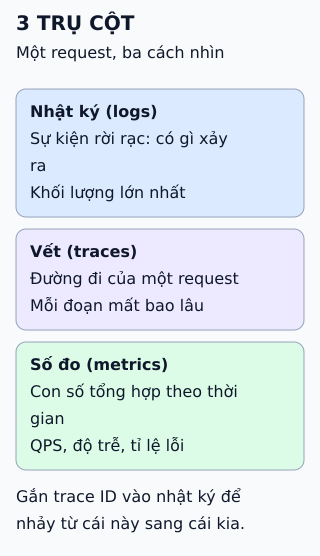

# Ba trụ cột quan sát: nhật ký, vết và số đo

Cùng một request chậm có thể nhìn bằng ba cách. Mỗi cách trả lời một câu hỏi khác.

## Nhìn hình thử trả lời

Bạn cần biết "độ trễ p99 của tuần trước tăng hay giảm". Dùng trụ cột nào?

Xem đáp án

Số đo (metrics), vì đó là dữ liệu đã tổng hợp theo thời gian. Muốn biết vì sao một request cụ thể chậm thì xem vết; muốn biết lỗi nào đã xảy ra thì đọc nhật ký.

## Giới hạn cần nhớ

Ba trụ cột là cách phân loại, không phải ba hệ thống phải xây riêng. Giá trị lớn nhất đến khi chúng liên kết với nhau (cùng trace ID, cùng nhãn dịch vụ).

Xem sâu hơn

- **Nhật ký:** dùng định dạng chung giữa các nhóm để tìm kiếm; ELK (Elasticsearch, Logstash, Kibana) là một lựa chọn phổ biến.
- **Vết:** thích hợp để tìm điểm nghẽn trong chuỗi gọi nhiều dịch vụ. **OpenTelemetry** cung cấp API, SDK và giao thức chung cho cả ba loại tín hiệu.
- **Số đo:** Prometheus thu bằng cách kéo và lưu trong kho riêng của nó; Alertmanager gửi cảnh báo, Grafana hiển thị. Nguồn nhắc InfluxDB như kho chuỗi thời gian; đó là một lựa chọn, không phải bắt buộc.

## Nguồn đối chiếu

- [ByteByteGo tại snapshot cố định](https://github.com/ByteByteGoHq/system-design-101/blob/b28380a4710c5ec9638ec037d4168e288f334cba/data/guides/logging-tracing-metrics.md).
- OpenTelemetry: [signals](https://opentelemetry.io/docs/concepts/signals/), [observability primer](https://opentelemetry.io/docs/concepts/observability-primer/).
- Prometheus: [tổng quan](https://prometheus.io/docs/introduction/overview/).
