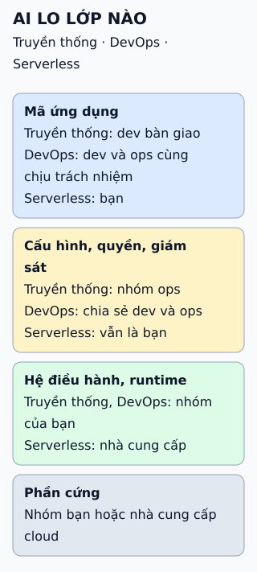

# DevOps và NoOps: ai lo phần vận hành

Hỏi theo từng lớp của hệ thống, ai chịu trách nhiệm ở mỗi mô hình? Câu trả lời cho thấy NoOps không xóa vận hành, chỉ dời nó.

**Đọc hình:** đọc từng thẻ: cùng một lớp, người chịu trách nhiệm đổi theo mô hình.

## Nhìn hình thử trả lời

Chạy mã trên một dịch vụ hàm không máy chủ. Ai vá hệ điều hành bên dưới, và ai theo dõi lỗi của hàm?

Xem đáp án

Nhà cung cấp cloud vá hệ điều hành. Bạn vẫn theo dõi lỗi, cấu hình, quyền truy cập và chi phí của hàm.

## Giới hạn cần nhớ

NoOps không có nghĩa là hết vận hành: sự cố, cảnh báo, giới hạn dịch vụ, bảo mật và chi phí vẫn cần người xử lý. Mức tải không tự nó loại bỏ serverless, vì nhiều dịch vụ tự mở rộng theo nhu cầu; điều cần cân nhắc là hình dạng công việc (theo sự kiện, biến động hay chạy liên tục), hạn mức của nhà cung cấp, yêu cầu độ trễ và mức kiểm soát hạ tầng bạn cần.

Xem sâu hơn

- **FaaS** chạy hàm theo sự kiện; **BaaS** cung cấp cơ sở dữ liệu, xác thực... dưới dạng dịch vụ.
- **Mô hình trách nhiệm chia sẻ:** nhà cung cấp lo "bản thân đám mây", khách hàng lo "những gì chạy trên đám mây".
- **DevOps** không xóa vai trò vận hành: có nơi gộp thành một nhóm, có nơi giữ hai nhóm cộng tác; điểm chung là trách nhiệm được chia sẻ.
- Nhiều tổ chức dùng cả ba mô hình cho các hệ thống khác nhau.

## Nguồn đối chiếu

- [ByteByteGo tại snapshot cố định](https://github.com/ByteByteGoHq/system-design-101/blob/b28380a4710c5ec9638ec037d4168e288f334cba/data/guides/devops-vs-noops.md).
- AWS: [mô hình DevOps](https://aws.amazon.com/devops/what-is-devops/), [mô hình trách nhiệm chia sẻ](https://aws.amazon.com/compliance/shared-responsibility-model/), [Lambda](https://docs.aws.amazon.com/lambda/latest/dg/welcome.html).
