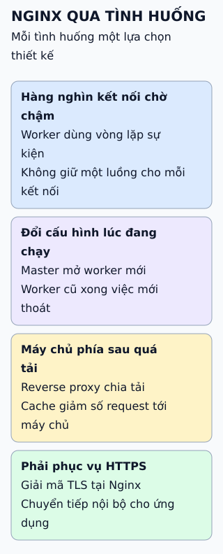

# Vì sao Nginx nhanh và phổ biến

Nginx dùng một tiến trình quản lý và vài tiến trình làm việc, mỗi tiến trình xử lý rất nhiều kết nối bằng vòng lặp sự kiện.

**Đọc hình:** master không xử lý request; worker làm hầu hết công việc.

## Nhìn hình thử trả lời

Đổi cấu hình Nginx và chạy `nginx -s reload`: kết nối đang xử lý có bị cắt không?

Xem đáp án

Không cắt đột ngột. Master kiểm tra cấu hình mới, mở worker mới theo cấu hình mới và yêu cầu worker cũ dừng sau khi xử lý xong kết nối hiện có.

## Giới hạn cần nhớ

I/O không chặn rất hợp cho nhiều kết nối ít việc; tác vụ nặng CPU hoặc thao tác chặn lâu trong một worker vẫn làm các kết nối khác trên worker đó chậm. Số worker thường đặt theo số lõi CPU.

Xem sâu hơn

- **Mô hình tiến trình:** nhiều worker để tận dụng nhiều lõi; mỗi worker vẫn đơn luồng trong vòng lặp sự kiện.
- **Reverse proxy:** nhận request từ client, chuyển tới máy chủ phía sau, trả kết quả về; có thể chia tải giữa nhiều máy chủ.
- **Cache nội dung:** lưu phản hồi để giảm tải cho máy chủ phía sau.
- **Kết thúc TLS:** Nginx giải mã HTTPS rồi chuyển tiếp nội bộ.

## Nguồn đối chiếu

- [ByteByteGo tại snapshot cố định](https://github.com/ByteByteGoHq/system-design-101/blob/b28380a4710c5ec9638ec037d4168e288f334cba/data/guides/why-is-nginx-so-popular.md).
- Nginx: [hướng dẫn cơ bản](https://nginx.org/en/docs/beginners_guide.html), [kiến trúc, bài "Inside NGINX"](https://blog.nginx.org/blog/inside-nginx-how-we-designed-for-performance-scale).
