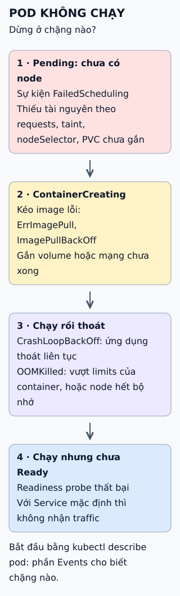

# Kubernetes: từ lệnh apply đến container chạy

Cách dễ hiểu kiến trúc cụm là đi theo một lệnh `kubectl apply` tạo Deployment và xem lần lượt thành phần nào làm gì.

**Đọc hình:** màu tím là mặt phẳng điều khiển, xanh là thành phần trên node; mọi thành phần nói chuyện qua API server.

## Nhìn hình thử trả lời

Hai container trong cùng một Pod gọi nhau bằng địa chỉ nào?

Xem đáp án

`localhost`. Các container trong một Pod dùng chung không gian mạng nên cùng một IP và gọi nhau qua `localhost` bằng cổng khác nhau.

## Giới hạn cần nhớ

Chạy một mặt phẳng điều khiển trên một máy thì không chịu được lỗi. Môi trường production thường chạy nhiều bản của mặt phẳng điều khiển và nhiều node. Bài này đơn giản hóa luồng: thực tế còn nhiều bước kiểm tra và vòng lặp phản hồi.

Xem sâu hơn

- **API server** là thành phần duy nhất đọc ghi etcd; kubectl, controller, scheduler và kubelet đều đi qua nó.
- **etcd** lưu trạng thái cụm nên cần sao lưu.
- **Controller manager** chạy nhiều controller; mỗi cái là vòng lặp so trạng thái mong muốn với hiện tại. Với Deployment, controller của Deployment tạo hoặc cập nhật ReplicaSet, rồi controller của ReplicaSet tạo Pod; nếu Deployment có mà thiếu Pod, hãy xem ReplicaSet ở giữa.
- **kubelet** nhận mô tả Pod gán cho node của nó và bảo đảm container chạy đúng.
- **kube-proxy** lập luật mạng trên node để Service tới đúng Pod.

## Nguồn đối chiếu

- [ByteByteGo tại snapshot cố định](https://github.com/ByteByteGoHq/system-design-101/blob/b28380a4710c5ec9638ec037d4168e288f334cba/data/guides/what-is-k8s-kubernetes.md).
- Kubernetes: [thành phần của cụm](https://kubernetes.io/docs/concepts/overview/components/), [Pod](https://kubernetes.io/docs/concepts/workloads/pods/).
