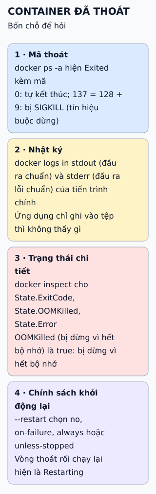

# Docker chạy thế nào: client, host và registry

Lệnh `docker` chỉ là client. Mỗi lệnh chạm tới nơi khác nhau; biết lệnh nào đi tới đâu giúp bạn gỡ lỗi mạng, quyền và dung lượng.

**Đọc hình:** client và daemon có thể ở cùng máy hoặc khác máy; lệnh nào cũng là một yêu cầu API tới daemon.

## Nhìn hình thử trả lời

`docker run` một image chưa có trên máy. Việc nào xảy ra trước khi container khởi động?

Xem đáp án

Daemon kéo image từ registry về kho cục bộ trước, rồi mới tạo và khởi động container.

## Giới hạn cần nhớ

`docker run` chỉ kéo image khi nó chưa có sẵn cục bộ; nếu đã có (kể cả bản cũ cùng tag), Docker dùng bản đó. Muốn bản mới nhất của tag thì kéo lại.

Xem sâu hơn

- **build:** gửi ngữ cảnh build (Dockerfile và các tệp liên quan) cho daemon; kết quả là một image trong kho cục bộ.
- **pull và push:** chép image giữa kho cục bộ và registry; không tạo container nào.
- **run:** gộp `docker create` (dựng container từ image cùng cấu hình như mạng, volume, biến môi trường) và `docker start`.
- Vì mọi lệnh đều là yêu cầu API tới daemon, client và daemon có thể ở hai máy khác nhau.

## Nguồn đối chiếu

- [ByteByteGo tại snapshot cố định](https://github.com/ByteByteGoHq/system-design-101/blob/b28380a4710c5ec9638ec037d4168e288f334cba/data/guides/how-does-docker-work.md).
- Docker: [tổng quan kiến trúc](https://docs.docker.com/get-started/docker-overview/), [docker run](https://docs.docker.com/reference/cli/docker/container/run/).
