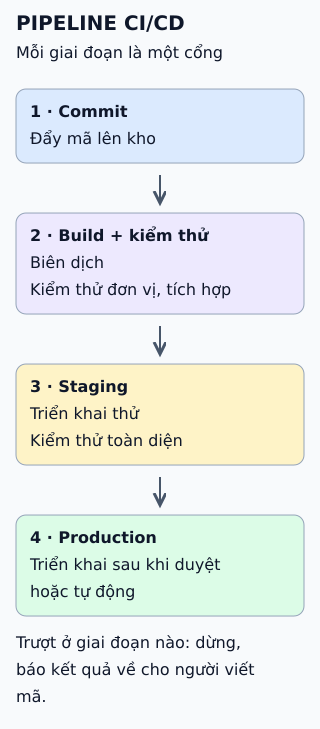

# Pipeline CI/CD qua từng giai đoạn

Pipeline là chuỗi giai đoạn, mỗi giai đoạn là một cổng kiểm tra. Qua hết cổng thì mới tới production; trượt cổng nào thì quay về cho người viết mã.

**Đọc hình:** mũi tên xuống là đường qua cổng; ghi chú cuối là đường trượt.

## Nhìn hình thử trả lời

Kiểm thử đơn vị ở giai đoạn 2 thất bại. Giai đoạn 3 có chạy không?

Xem đáp án

Không. Pipeline dừng ở giai đoạn trượt (fail fast) để tiết kiệm thời gian và không đưa bản lỗi đi tiếp.

## Giới hạn cần nhớ

Pipeline xanh không bảo đảm không có lỗi: nó chỉ chứng minh các kiểm tra đã viết đều qua. Kiểm thử chập chờn (khi qua khi trượt) làm mọi người mất tin và bỏ qua kết quả đỏ.

Xem sâu hơn

- **Fail fast:** đặt kiểm tra nhanh và rẻ ở đầu; kiểm tra chậm và đắt ở sau.
- **Cùng một sản phẩm build:** build một lần, đưa cùng sản phẩm qua các môi trường, để thứ được kiểm thử là thứ được phát hành.
- **Phản hồi nhanh:** kết quả cần về cho người viết mã trong thời gian đủ ngắn để họ còn nhớ thay đổi.
- **Cổng duyệt:** có thể là người bấm duyệt (Continuous Delivery) hoặc quy tắc tự động (Continuous Deployment).

## Nguồn đối chiếu

- [ByteByteGo tại snapshot cố định](https://github.com/ByteByteGoHq/system-design-101/blob/b28380a4710c5ec9638ec037d4168e288f334cba/data/guides/cicd-pipeline-explained-in-simple-terms.md).
- Martin Fowler: [DeploymentPipeline](https://martinfowler.com/bliki/DeploymentPipeline.html), [Continuous Integration](https://martinfowler.com/articles/continuousIntegration.html).
