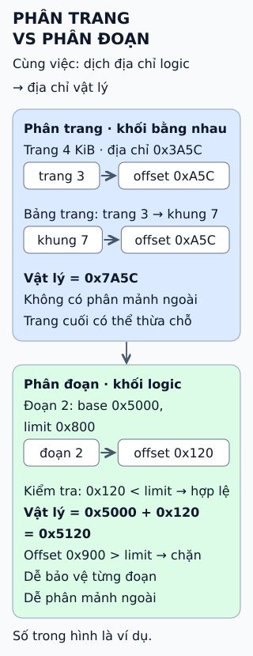

# Phân trang và phân đoạn

**Chương trình dùng địa chỉ "logic"; RAM có địa chỉ vật lý.** Hệ điều hành cùng phần cứng phải dịch từ cái này sang cái kia. Phân trang và phân đoạn là hai cách chia bộ nhớ để làm việc đó.

## Đọc hình

**Phân trang.** Bộ nhớ logic chia thành *trang*, RAM chia thành *khung* cùng kích thước (ví dụ 4 KiB). Địa chỉ logic tách thành số trang và offset. Bảng trang cho biết trang nằm ở khung nào; địa chỉ vật lý ghép số khung với chính offset đó. Trong ví dụ, 0x3A5C là trang 3, offset 0xA5C; trang 3 nằm ở khung 7 nên địa chỉ thật là 0x7A5C.

**Phân đoạn.** Chương trình được chia theo ý nghĩa — mã, dữ liệu, stack — mỗi đoạn một độ dài. Bảng đoạn ghi *base* (nơi bắt đầu) và *limit* (độ dài). Offset phải nhỏ hơn limit, rồi mới cộng với base. Offset 0x900 vượt limit 0x800 nên bị chặn.

## Giới hạn cần nhớ

Đây không phải cuộc thi có người thắng. Phân trang không có phân mảnh ngoài (nhiều khe hở rải rác, quá nhỏ để dùng) nhưng có phân mảnh trong: trang cuối của một vùng có thể thừa chỗ. Phân đoạn khớp với cấu trúc chương trình và dễ bảo vệ từng đoạn, nhưng các đoạn dài ngắn khác nhau để lại khe hở khi cấp phát và giải phóng. Hệ điều hành trên x86-64 hiện nay chủ yếu dựa vào phân trang.

## Nhìn hình thử trả lời

Với trang 4 KiB, địa chỉ 0x2010 thuộc trang nào, offset bao nhiêu? Nếu trang 2 nằm ở khung 9 thì địa chỉ vật lý là gì?

Xem đáp án

Trang 2, offset 0x010. Ghép khung 9 với offset đó: 0x9010.

Xem sâu hơn

- **Vì sao dùng lũy thừa của 2:** kích thước trang 4 KiB = 2¹², nên 12 bit thấp là offset, các bit còn lại là số trang; phần cứng tách địa chỉ không cần phép chia.
- **Bảng trang rất lớn:** với địa chỉ rộng, bảng trang thường nhiều cấp và được phần cứng lưu tạm trong TLB để khỏi tra bảng ở mỗi lần truy cập.
- **Kết hợp:** một số kiến trúc cũ dùng phân đoạn rồi phân trang. Ở chế độ 64 bit của x86-64, hầu hết thanh ghi đoạn coi base bằng 0, nên bộ nhớ gần như phẳng.

Con số trong hình chỉ để minh họa; kích thước trang thật phụ thuộc phần cứng và hệ điều hành.

## Nguồn đối chiếu

- [ByteByteGo tại snapshot cố định](https://github.com/ByteByteGoHq/system-design-101/blob/b28380a4710c5ec9638ec037d4168e288f334cba/data/guides/what-are-the-differences-between-paging-and-segmentation.md).
- [OSTEP — Segmentation](https://pages.cs.wisc.edu/~remzi/OSTEP/vm-segmentation.pdf) và [Paging: Introduction](https://pages.cs.wisc.edu/~remzi/OSTEP/vm-paging.pdf): base/limit, trang/khung, phân mảnh.
- [Intel SDM](https://www.intel.com/content/www/us/en/developer/articles/technical/intel-sdm.html): phân đoạn và phân trang ở chế độ 64 bit.

Đã đọc nguồn ngày 2026-10-13; các tài liệu chuẩn nêu trên chưa được mở để đối chiếu trực tiếp trong lượt biên soạn này. Bài viết và hình được thiết kế độc lập.
