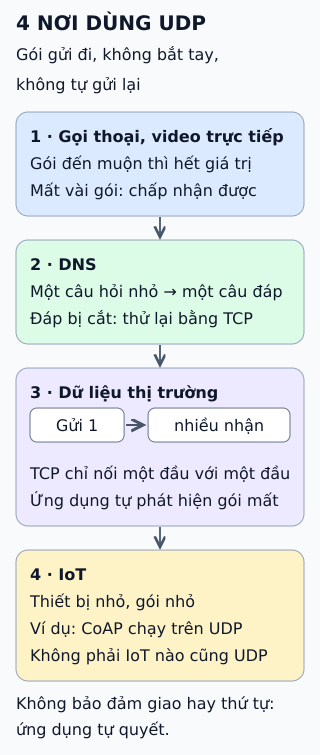

# Bốn nơi UDP thường được dùng

**UDP gửi từng gói độc lập: không bắt tay, không tự gửi lại, không bảo đảm thứ tự.** Nghe như khuyết điểm, nhưng có những việc cần đúng điều đó: ít chờ đợi, ít trạng thái.

## Đọc hình

**1 · Gọi thoại, video trực tiếp.** Một khung âm thanh đến trễ thường vô ích: cuộc gọi đã đi tiếp. Gửi lại gói cũ chỉ làm trễ thêm, nên mất vài gói được chấp nhận hơn là chờ.

**2 · DNS.** Truy vấn nhỏ, một gói hỏi và một gói đáp, nên chi phí bắt tay của TCP là thừa. Khi câu đáp quá lớn hoặc khi sao chép vùng, DNS dùng TCP.

**3 · Dữ liệu thị trường.** Cùng một bản tin cần tới nhiều bên nhận. Multicast gửi một lần và mạng nhân bản; TCP nối đúng một đầu với một đầu nên không làm được việc này. Bên nhận tự phát hiện gói mất, ví dụ bằng số thứ tự.

**4 · IoT.** Thiết bị nhỏ, bộ nhớ ít, gói ngắn. Giao thức như CoAP chạy trên UDP và tự thêm xác nhận khi cần.

## Giới hạn cần nhớ

UDP không "nhanh hơn" theo nghĩa nó làm việc thông minh hơn; nó chỉ làm ít việc hơn. Mọi thứ còn thiếu — thứ tự, gửi lại, chống quá tải mạng — do ứng dụng tự lo hoặc tự bỏ qua. Không phải IoT nào cũng dùng UDP, và một số mạng chặn hoặc hạn chế UDP.

## Nhìn hình thử trả lời

Ứng dụng chuyển tiền cần mỗi lệnh đến đủ, đúng thứ tự. Chọn UDP thuần có hợp lý không? Vì sao?

Xem đáp án

Không hợp lý. UDP thuần không bảo đảm giao hay thứ tự. Có thể dùng UDP cộng lớp tin cậy tự xây, nhưng thông thường dùng TCP hoặc giao thức có sẵn sự bảo đảm đó.

Xem sâu hơn

- **Datagram:** mỗi gói UDP mang tiêu đề 8 byte (cổng nguồn, cổng đích, độ dài, checksum) và tự độc lập.
- **DNS qua TCP:** khi câu đáp bị cắt hoặc quá lớn, client thử lại bằng TCP; việc sao chép vùng dùng TCP.
- **Chống quá tải:** UDP không tự giảm tốc khi mạng nghẽn; ứng dụng gửi lượng lớn cần tự điều tiết.
- **Multicast:** thường chỉ chạy được trong mạng được cấu hình hỗ trợ, ít khi qua Internet công cộng.

## Nguồn đối chiếu

- [ByteByteGo tại snapshot cố định](https://github.com/ByteByteGoHq/system-design-101/blob/b28380a4710c5ec9638ec037d4168e288f334cba/data/guides/top-4-most-popular-use-cases-for-udp.md).
- [RFC 768 — UDP](https://www.rfc-editor.org/rfc/rfc768) và [RFC 8085 — Hướng dẫn dùng UDP](https://www.rfc-editor.org/rfc/rfc8085).
- [RFC 3550 — RTP](https://www.rfc-editor.org/rfc/rfc3550); [RFC 1112 — IP multicast](https://www.rfc-editor.org/rfc/rfc1112).
- [RFC 1035 — DNS](https://www.rfc-editor.org/rfc/rfc1035) và [RFC 7766 — DNS qua TCP](https://www.rfc-editor.org/rfc/rfc7766); [RFC 7252 — CoAP](https://www.rfc-editor.org/rfc/rfc7252).

Đã đọc nguồn ngày 2026-10-13. Bài viết và hình được thiết kế độc lập; chỉ giữ bốn nhóm ứng dụng của nguồn.
