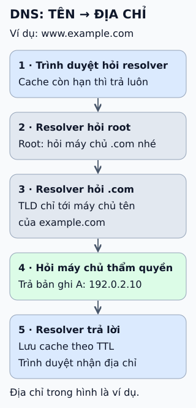

# DNS tra cứu hoạt động thế nào?

**Người nhớ tên, máy cần địa chỉ.** DNS là hệ thống phân cấp trả lời câu hỏi "tên này ứng với địa chỉ IP nào?". Không có máy chủ nào biết hết, nên truy vấn đi theo từng bậc.

## Từ viết tắt

- **DNS** (Domain Name System) — hệ thống tên miền: "danh bạ" của Internet, đổi tên miền như example.com thành địa chỉ IP.
- **IP** (Internet Protocol) — giao thức Internet: quy ước đánh địa chỉ và chuyển gói tin giữa các máy; địa chỉ IP là địa chỉ của một máy trên mạng.
- **TLD** (Top-Level Domain) — miền cấp cao nhất: phần cuối cùng của tên miền, như .com.
- **TTL** (Time To Live) — thời gian sống: khoảng thời gian một bản ghi trong bộ nhớ đệm được coi là còn dùng được trước khi hết hạn.
- **DNSSEC** (DNS SECurity) — bảo mật cho DNS: thêm chữ ký số vào dữ liệu DNS để kiểm tra nó không bị làm giả; bài này không đi sâu vào nó.

## Đọc hình

Ví dụ tra `www.example.com`.

**1.** Trình duyệt (qua hệ điều hành) hỏi *resolver* — máy chủ thay bạn đi hỏi. Nếu đã có câu trả lời còn hạn trong cache, nó trả luôn.

**2.** Chưa có cache, resolver hỏi *root server*. Root không biết địa chỉ của `www.example.com`, nó chỉ tới các máy chủ của `.com`.

**3.** Resolver hỏi máy chủ `.com` (TLD). Máy chủ này chỉ tới máy chủ tên của `example.com`.

**4.** Resolver hỏi *máy chủ có thẩm quyền* của `example.com` và nhận bản ghi A, ở đây là địa chỉ minh họa 192.0.2.10.

**5.** Resolver trả địa chỉ cho trình duyệt và lưu lại trong thời gian TTL.

## Giới hạn cần nhớ

Cache là lý do DNS nhanh, cũng là lý do thay đổi bản ghi không có hiệu lực tức thì: resolver có thể còn dùng câu trả lời cũ cho tới khi hết TTL. Vì vậy nếu định đổi địa chỉ, hãy hạ TTL từ trước, sớm hơn ít nhất một khoảng TTL cũ. Địa chỉ trong hình chỉ để minh họa.

## Nhìn hình thử trả lời

Bạn vừa đổi bản ghi A của tên miền sang máy chủ mới, TTL cũ là 1 giờ. Vì sao vài người dùng vẫn vào máy chủ cũ?

Xem đáp án

Resolver của họ đã cache câu trả lời cũ và có thể dùng tới hết TTL. Máy chủ có thẩm quyền đã đổi, nhưng cache ở giữa chưa hết hạn.

Xem sâu hơn

- **Ba bậc:** root, TLD, máy chủ có thẩm quyền. Có 13 danh tính root server logic (a đến m); mỗi cái được nhiều máy phục vụ bằng anycast.
- **Resolver và máy chủ có thẩm quyền khác vai:** resolver đi hỏi và cache; máy chủ có thẩm quyền giữ dữ liệu của vùng.
- **Hỏi lặp:** root và TLD thường trả "hãy hỏi máy chủ này" thay vì tự đi tìm đáp án; resolver đi từng bước.
- **Cache âm:** câu trả lời "không tồn tại" cũng có thể được cache.
- **Chi tiết khác:** DNSSEC, mã hóa truy vấn (DoH, DoT) nằm ngoài bài này.

## Nguồn đối chiếu

- [ByteByteGo tại snapshot cố định](https://github.com/ByteByteGoHq/system-design-101/blob/b28380a4710c5ec9638ec037d4168e288f334cba/data/guides/how-does-the-domain-name-system-dns-lookup-work.md).
- [RFC 1034](https://www.rfc-editor.org/rfc/rfc1034) và [RFC 1035](https://www.rfc-editor.org/rfc/rfc1035): khái niệm và cài đặt DNS.
- [RFC 9499 — Thuật ngữ DNS](https://www.rfc-editor.org/rfc/rfc9499): resolver, máy chủ có thẩm quyền, TTL.
- [Root Servers](https://root-servers.org/): danh sách và anycast.

Đã đọc nguồn ngày 2026-10-13; các tài liệu chuẩn nêu trên chưa được mở để đối chiếu trực tiếp trong lượt biên soạn này. Bài viết và hình được thiết kế độc lập.
