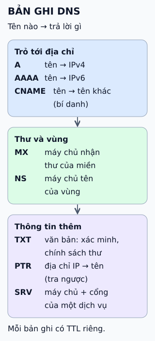

# Các loại bản ghi DNS cần biết

**Một tên miền không chỉ có một địa chỉ.** Dữ liệu DNS là các *bản ghi* có loại; mỗi loại trả lời một kiểu câu hỏi — địa chỉ ở đâu, thư gửi về đâu, ai quản lý vùng này.



## Từ viết tắt

- **DNS** (Domain Name System) — hệ thống tên miền: "danh bạ" của Internet, đổi tên miền như example.com thành địa chỉ IP.
- **IP** (Internet Protocol) — giao thức Internet: quy ước đánh địa chỉ và chuyển gói tin giữa các máy; địa chỉ IP là địa chỉ của một máy trên mạng.
- **IPv4** (Internet Protocol version 4) — phiên bản 4 của giao thức IP: địa chỉ gồm bốn số từ 0 đến 255 như 203.0.113.10; số địa chỉ có hạn.
- **IPv6** (Internet Protocol version 6) — phiên bản 6 của giao thức IP: địa chỉ dài hơn IPv4 nhiều, dùng khi IPv4 hết địa chỉ.
- **AAAA** (Quad A) — bản ghi AAAA, đọc là "quad A": loại bản ghi DNS trả về địa chỉ IPv6 của một tên; địa chỉ IPv6 dài gấp bốn lần địa chỉ IPv4 nên tên có bốn chữ A.
- **CNAME** (Canonical NAME) — bản ghi tên chính tắc: biến một tên thành bí danh của tên khác, resolver tra tiếp tên đích.
- **MX** (Mail eXchange) — bản ghi trao đổi thư: chỉ máy chủ nhận thư của một miền.
- **NS** (Name Server) — bản ghi máy chủ tên: chỉ máy chủ tên chịu trách nhiệm cho một vùng.
- **TXT** (TeXT) — bản ghi văn bản: chứa văn bản tự do, như xác minh quyền sở hữu miền.
- **PTR** (PoinTeR) — bản ghi con trỏ: tra ngược từ địa chỉ IP ra tên.
- **SRV** (SeRVice) — bản ghi dịch vụ: chỉ máy chủ và cổng của một dịch vụ.
- **SOA** (Start Of Authority) — bản ghi bắt đầu thẩm quyền: thông tin gốc của một vùng DNS.
- **SPF** (Sender Policy Framework) — khung chính sách người gửi: cho biết máy nào được gửi thư thay mặt một miền; ngày nay thường khai trong bản ghi TXT.
- **CAA** (Certification Authority Authorization) — bản ghi ủy quyền cấp chứng chỉ: giới hạn tổ chức cấp chứng chỉ nào được cấp chứng chỉ cho miền.
- **CA** (Certificate Authority) — tổ chức cấp chứng chỉ: bên ký xác nhận rằng một khóa công khai thuộc về một tên hay một tổ chức.
- **DS** (Delegation Signer) — bản ghi người ký ủy quyền: bản ghi của DNSSEC chứa mã băm khóa DNSKEY của vùng con.
- **DNSKEY** (DNS KEY) — bản ghi khóa DNS: bản ghi của DNSSEC chứa khóa công khai dùng để kiểm chữ ký.
- **DNSSEC** (DNS SECurity) — bảo mật cho DNS: thêm chữ ký số vào dữ liệu DNS để kiểm tra nó không bị làm giả; bài này không đi sâu vào nó.
- **TTL** (Time To Live) — thời gian sống: khoảng thời gian một bản ghi trong bộ nhớ đệm được coi là còn dùng được trước khi hết hạn.
- **RRset** (Resource Record set) — tập bản ghi tài nguyên: các bản ghi cùng tên, loại và lớp; TTL thuộc về cả tập chứ không phải từng bản ghi.

## Đọc hình

- **A / AAAA:** tên → địa chỉ IPv4 / IPv6.
- **CNAME:** đặt tên này là *bí danh* của tên khác; resolver tra tiếp tên đích. Tên có CNAME không được có bản ghi loại khác cùng tên (trừ bản ghi của DNSSEC).
- **MX:** miền nhận thư ở máy chủ nào; có thứ tự ưu tiên.
- **NS:** máy chủ tên chịu trách nhiệm cho vùng, dùng để ủy quyền xuống cấp dưới.
- **TXT:** văn bản tự do; thường chứa xác minh quyền sở hữu miền và chính sách thư như SPF.
- **PTR:** tra *ngược* từ địa chỉ IP ra tên, nằm trong vùng đặc biệt của dải địa chỉ.
- **SRV:** máy chủ và cổng cho một dịch vụ cụ thể; tên máy chủ đó lại cần bản ghi A hoặc AAAA.

## Giới hạn cần nhớ

Bản ghi không tự bảo đảm đáng tin: TXT chứa gì cũng được, PTR do chủ dải địa chỉ đặt chứ không do chủ tên miền xác nhận. TTL thuộc về cả tập bản ghi cùng tên, loại và lớp (RRset), không phải từng bản ghi lẻ, nên thay đổi lan chậm. CNAME ở *gốc* của miền (apex) thường không được phép, vì gốc đã phải có SOA và NS.

## Nhìn hình thử trả lời

Bạn muốn `www.example.com` luôn đi theo địa chỉ của `app.example.net`, dù địa chỉ đó đổi. Dùng bản ghi nào?

<details>
<summary>Xem đáp án</summary>

CNAME trên `www.example.com` trỏ tới `app.example.net`. Khi `app.example.net` đổi địa chỉ, tên `www` tự theo.

</details>

<details>
<summary>Xem sâu hơn</summary>

```
example.com.      3600  IN  MX   10 mail.example.com.
www.example.com.  3600  IN  CNAME app.example.net.
mail.example.com. 3600  IN  A    192.0.2.25
```

- **MX** trỏ tới *tên* máy chủ, không trỏ thẳng IP; tên đó cần có A/AAAA.
- **Chưa kể:** SOA (thông tin vùng), CAA (giới hạn CA được cấp chứng chỉ), DS/DNSKEY (DNSSEC) và nhiều loại khác.
- **SPF** từng có loại bản ghi riêng; hiện nay dùng TXT.

</details>

## Nguồn đối chiếu

- [ByteByteGo tại snapshot cố định](https://github.com/ByteByteGoHq/system-design-101/blob/b28380a4710c5ec9638ec037d4168e288f334cba/data/guides/dns-record-types-you-should-know.md).
- [RFC 1035](https://www.rfc-editor.org/rfc/rfc1035): A, NS, CNAME, PTR, MX, TXT. [RFC 3596](https://www.rfc-editor.org/rfc/rfc3596): AAAA. [RFC 2782](https://www.rfc-editor.org/rfc/rfc2782): SRV.
- [RFC 2181 §10.1](https://www.rfc-editor.org/rfc/rfc2181) và [RFC 4034](https://www.rfc-editor.org/rfc/rfc4034): CNAME đứng một mình, trừ bản ghi DNSSEC.
- [RFC 7208](https://www.rfc-editor.org/rfc/rfc7208): SPF dùng TXT.

Đã đọc nguồn ngày 2026-10-13; các tài liệu chuẩn nêu trên chưa được mở để đối chiếu trực tiếp trong lượt biên soạn này. Bài viết và hình được thiết kế độc lập.
