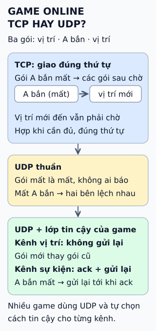

# TCP hay UDP cho game online?

**Trong game, dữ liệu cũ nhanh chóng mất giá trị.** Vị trí nhân vật từ 200 ms trước chẳng còn ai cần, nhưng "nhân vật A đã bắn" thì không được mất. Vì vậy câu hỏi không phải "TCP hay UDP", mà là từng loại dữ liệu cần bảo đảm gì.

## Đọc hình

Server gửi ba gói: vị trí, *A bắn*, vị trí mới. Gói *A bắn* bị mất.

**TCP.** Giao dữ liệu đúng thứ tự: gói vị trí mới đã tới nhưng bị giữ lại cho tới khi gói *A bắn* được gửi lại. Tốt khi cần đủ và đúng thứ tự; tệ khi dữ liệu mới hơn có thể thay thế dữ liệu cũ.

**UDP thuần.** Gói mất là mất, không ai báo. Game sẽ lệch trạng thái nếu sự kiện quan trọng bị bỏ.

**UDP cộng lớp tin cậy của game.** Game tự quy ước: kênh *vị trí* không gửi lại vì gói mới thay gói cũ; kênh *sự kiện* gắn số thứ tự, bên nhận xác nhận (ack), bên gửi gửi lại tới khi có ack.

## Giới hạn cần nhớ

Không có "UDP tin cậy" duy nhất để cắm vào: mỗi game hoặc thư viện chọn cách riêng, và phải tự lo thêm như chống quá tải mạng. Cũng không phải game nào cũng bỏ TCP — game chậm nhịp, lobby, mua bán vẫn dùng TCP hoặc HTTP bình thường. "UDP nhanh hơn" chỉ đúng khi ứng dụng thật sự tận dụng được việc không phải chờ.

## Nhìn hình thử trả lời

Bạn nên gửi lại gói vị trí nhân vật bị mất không? Còn gói "nhặt được vật phẩm hiếm"?

Xem đáp án

Vị trí: thường không, vì gói vị trí mới hơn sẽ thay nó. Nhặt vật phẩm: có; sự kiện này phải tới đủ và được xác nhận.

Xem sâu hơn

- **Chặn đầu hàng (head-of-line blocking):** TCP là một dòng byte có thứ tự, nên một gói mất làm các gói sau phải chờ dù đã tới.
- **Trạng thái cuối cùng:** nhiều game gửi liên tục ảnh chụp trạng thái, nên mất một gói thì gói kế tiếp bù lại.
- **QUIC:** giao thức trên UDP cung cấp nhiều luồng độc lập có gửi lại, giảm chặn đầu hàng giữa các luồng; game có thể dùng thư viện riêng hoặc QUIC tùy nhu cầu.
- **Không giữ nguyên tên:** bài nguồn gọi cách làm là RUDP; đây không phải một chuẩn duy nhất.

## Nguồn đối chiếu

- [ByteByteGo tại snapshot cố định](https://github.com/ByteByteGoHq/system-design-101/blob/b28380a4710c5ec9638ec037d4168e288f334cba/data/guides/what-protocol-does-online-gaming-use-to-transmit-data.md).
- [Gaffer On Games — UDP vs. TCP](https://gafferongames.com/post/udp_vs_tcp/).
- [Valve — Source Multiplayer Networking](https://developer.valvesoftware.com/wiki/Source_Multiplayer_Networking).
- [RFC 8085 — Hướng dẫn dùng UDP](https://www.rfc-editor.org/rfc/rfc8085) và [RFC 9000 — QUIC](https://www.rfc-editor.org/rfc/rfc9000).

Đã đọc nguồn ngày 2026-10-13. Bài viết và hình được thiết kế độc lập; không giữ câu "much lower latency than TCP" của bài nguồn vì còn tùy cách thiết kế.
