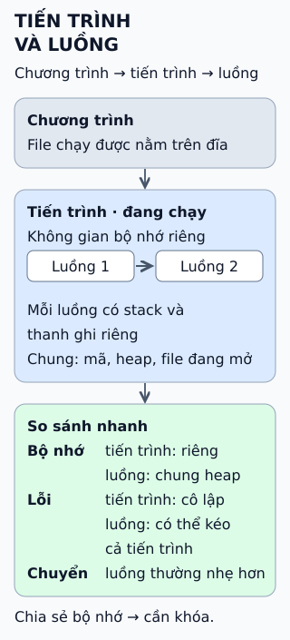

# Tiến trình và luồng

**Một chương trình trên đĩa chưa làm gì cả.** Khi chạy, hệ điều hành tạo *tiến trình*; bên trong tiến trình có một hoặc nhiều *luồng* thực sự thi hành lệnh.

## Đọc hình

**Chương trình** là file nằm yên trên đĩa. **Tiến trình** là chương trình đang chạy cùng không gian bộ nhớ và tài nguyên (file đang mở...) hệ điều hành cấp cho nó. **Luồng** là một dòng thi hành bên trong tiến trình.

Các luồng của cùng một tiến trình *chung* mã, heap và file đang mở, nhưng mỗi luồng có *stack* và thanh ghi riêng để biết mình đang ở dòng lệnh nào.

Hai tiến trình khác nhau có không gian bộ nhớ tách biệt: tiến trình này không thể đọc bộ nhớ của tiến trình kia nếu hệ điều hành không cho. Giữa các luồng thì chẳng có hàng rào nào.

## Giới hạn cần nhớ

Chung bộ nhớ là ưu điểm và cũng là rủi ro. Hai luồng cùng ghi một biến mà không có khóa gây *race condition*: kết quả phụ thuộc thứ tự xen kẽ. Một luồng gây lỗi nghiêm trọng có thể kéo cả tiến trình chết. Tách thành nhiều tiến trình dễ cô lập lỗi hơn nhưng tốn hơn và giao tiếp khó hơn. Không có lựa chọn "luôn tốt hơn".

## Nhìn hình thử trả lời

Hai luồng cùng chạy `dem = dem + 1` trên một biến chung, mỗi luồng 1000 lần. Kết quả luôn là 2000 chứ?

Xem đáp án

Không bảo đảm. Phép cộng gồm đọc, cộng, ghi; hai luồng có thể cùng đọc một giá trị rồi cùng ghi đè nhau, làm mất lần cộng. Cần khóa hoặc phép cộng nguyên tử.

Xem sâu hơn

- **Chi phí:** chuyển giữa hai luồng của cùng tiến trình thường rẻ hơn chuyển giữa hai tiến trình, vì không phải đổi không gian địa chỉ; mức chênh lệch tùy hệ điều hành và phần cứng.
- **Giao tiếp:** các tiến trình dùng cơ chế liên tiến trình (pipe, socket, bộ nhớ chia sẻ); các luồng đọc ghi bộ nhớ chung nhưng cần đồng bộ.
- **Trên Linux:** luồng nhân được tạo như một tác vụ chia sẻ bộ nhớ với tác vụ cha.
- **Hệ thống thực tế:** nhiều ứng dụng kết hợp, ví dụ trình duyệt dùng nhiều tiến trình, mỗi tiến trình lại có nhiều luồng; cách chia cụ thể tùy sản phẩm.

## Nguồn đối chiếu

- [ByteByteGo tại snapshot cố định](https://github.com/ByteByteGoHq/system-design-101/blob/b28380a4710c5ec9638ec037d4168e288f334cba/data/guides/what-is-the-difference-between-process-and-thread.md).
- [OSTEP — The Abstraction: The Process](https://pages.cs.wisc.edu/~remzi/OSTEP/cpu-intro.pdf) và [Concurrency: An Introduction](https://pages.cs.wisc.edu/~remzi/OSTEP/threads-intro.pdf).
- [Linux — clone(2)](https://man7.org/linux/man-pages/man2/clone.2.html): tác vụ chia sẻ bộ nhớ.

Đã đọc nguồn ngày 2026-10-13. Bài viết và hình được thiết kế độc lập; không giữ ví dụ "mỗi tab Chrome một tiến trình" vì cách chia thay đổi theo phiên bản.
