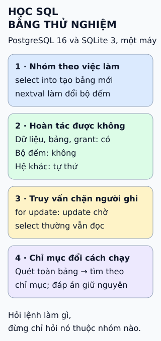

# Cách học SQL

**Đọc cả bộ chuẩn SQL không phải cách học.** Chuẩn dài và có nhiều bản, còn các hệ quản trị đều có điểm riêng. Cách thực tế là chia SQL thành nhóm lệnh, rồi học nhóm cần cho việc của mình trước.

## Đọc hình

Năm nhóm thường dùng để học:

- **DDL** — định nghĩa cấu trúc: `CREATE`, `ALTER`, `DROP`.
- **DQL** — truy vấn: `SELECT`.
- **DML** — thay đổi dữ liệu: `INSERT`, `UPDATE`, `DELETE`.
- **DCL** — phân quyền: `GRANT`, `REVOKE`.
- **TCL** — giao dịch: `COMMIT`, `ROLLBACK`.

**Lộ trình gợi ý.** Bắt đầu với `SELECT`, `WHERE`, `ORDER BY`; sang `JOIN` và `GROUP BY`; rồi thêm/sửa/xóa dữ liệu; hiểu giao dịch; cuối cùng thiết kế bảng, ràng buộc và chỉ mục.

**Chọn trọng tâm.** Người phân tích dữ liệu đi sâu DQL: nối bảng, gom nhóm, hàm cửa sổ. Người làm backend cần DML, DDL, giao dịch và chỉ mục.

## Giới hạn cần nhớ

Năm nhóm là cách chia để dạy, không phải điều luật; sách và nhà cung cấp khác nhau xếp `SELECT` vào DML hoặc tách riêng. Phương ngữ cũng khác: PostgreSQL, MySQL, SQLite và SQL Server có cú pháp và hành vi riêng. Hãy luyện trên một hệ cụ thể và đối chiếu tài liệu của chính hệ đó.

## Nhìn hình thử trả lời

Bạn cần cấp quyền đọc bảng `orders` cho một người dùng. Lệnh thuộc nhóm nào?

Xem đáp án

DCL (phân quyền), ví dụ `GRANT SELECT ON orders TO nguoi_dung;`. Tên người dùng và cú pháp chính xác tùy hệ quản trị.

Xem sâu hơn

- **Luyện tập:** chọn một bộ dữ liệu nhỏ, tự đặt câu hỏi rồi viết truy vấn trả lời; đối chiếu kết quả bằng tay với vài dòng.
- **Giao dịch:** thử `BEGIN`, thay đổi, rồi `ROLLBACK` để thấy dữ liệu trở lại như cũ.
- **Chuẩn SQL:** do ISO/IEC 9075 duy trì, có nhiều bản (ví dụ SQL:2016 và SQL:2023); hệ quản trị thường chỉ hỗ trợ một phần.

## Nguồn đối chiếu

- [ByteByteGo tại snapshot cố định](https://github.com/ByteByteGoHq/system-design-101/blob/b28380a4710c5ec9638ec037d4168e288f334cba/data/guides/what-is-the-best-way-to-learn-sql.md).
- [PostgreSQL — Tutorial SQL](https://www.postgresql.org/docs/current/tutorial.html), [Transactions](https://www.postgresql.org/docs/current/tutorial-transactions.html) và [SQL Conformance](https://www.postgresql.org/docs/current/features.html).
- [Oracle — Types of SQL Statements](https://docs.oracle.com/en/database/oracle/oracle-database/19/sqlrf/Types-of-SQL-Statements.html): một cách phân nhóm lệnh khác.

Đã đọc nguồn ngày 2026-10-13; các tài liệu chuẩn nêu trên chưa được mở để đối chiếu trực tiếp trong lượt biên soạn này. Bài viết và hình được thiết kế độc lập.
